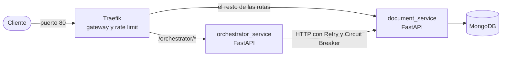
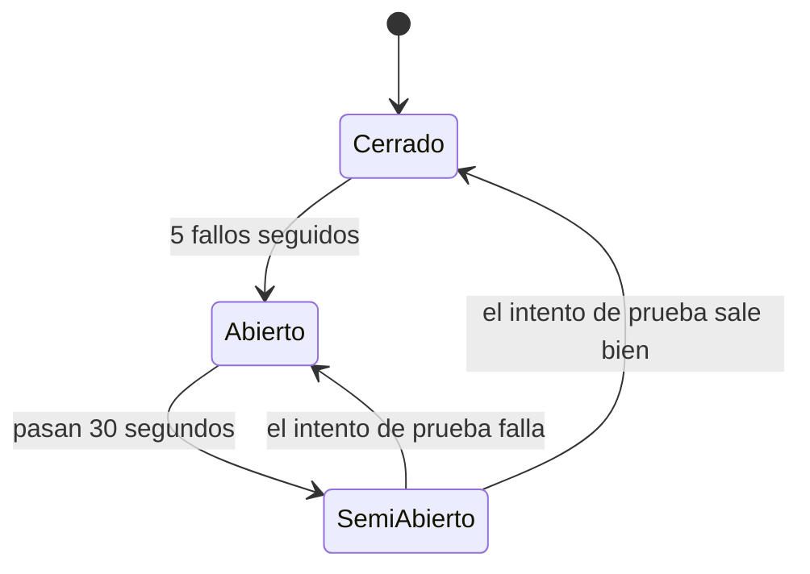

# Integrantes del grupo
Agustin Salcedo, Juan Pablo Cañada, Nicolas Martínez, Carlos Reta, Santiago Miscovich

## Arquitectura

El sistema está compuesto por **dos microservicios**, un gateway y una base de datos, todo levantado con Docker Compose:



| Pieza | Qué hace | Contenedor |
|---|---|---|
| **Traefik** (puerto 80) | Gateway único de entrada. Enruta el tráfico a cada microservicio y aplica rate limiting por IP (responde `429 Too Many Requests` a quien mande demasiados pedidos por segundo). | `traefik_gateway` |
| **document_service** (FastAPI) | Extracción de texto de PDFs y persistencia de documentos en MongoDB. Responde en `/documents`, `/health` y `/docs`. | `document_service` |
| **orchestrator_service** (FastAPI) | Coordina llamadas a otros microservicios. Hoy consulta el estado de `document_service`. Responde en `/orchestrator`. | `orchestrator_service` |
| **MongoDB** (puerto 27017) | Base de datos de documentos. | `proyecto_desarrollo_db` |

Todo el tráfico externo debe entrar por Traefik (`http://localhost`, **sin** `:8000`). Los microservicios no exponen su puerto hacia afuera.

### Servicios vs. microservicios

Se distingue entre las **unidades desplegables** (microservicios) y la **capa de lógica de negocio** (servicios) que vive dentro de cada una:

- **Microservicio:** programa independiente, con su propio `Dockerfile`, sus dependencias, sus tests y su contenedor. Se puede construir, reiniciar o apagar sin tocar al otro. Viven en `microservices/`.
- **Servicio:** la capa `services/` interna de cada microservicio. Contiene las reglas de negocio y se apoya en repositorios (acceso a datos) o clientes (llamadas a otros microservicios).

```
microservices/
├── document_service/
│   ├── app/                    core · models · schemas · repositories · services · routes
│   ├── tests/
│   ├── Dockerfile
│   └── requirements.txt
└── orchestrator_service/
    ├── orchestrator_service/   core · schemas · clients · services · routes
    ├── tests/
    ├── Dockerfile
    └── requirements.txt
docker-compose.yml
k6-tests/
```

## Observabilidad y resiliencia

### Health checks

Cada microservicio distingue dos preguntas diferentes:

- **Liveness** (`live`): ¿el proceso está vivo? No consulta dependencias. Es lo que usa Docker para decidir si reinicia el contenedor.
- **Readiness** (`ready`): ¿puede atender pedidos ahora? Verifica sus dependencias y responde `503` si alguna falla.

| Microservicio | Endpoint | Qué verifica |
|---|---|---|
| document_service | `GET /health/live` | Proceso vivo. Devuelve versión y `uptime_seconds`. |
| document_service | `GET /health/ready` (alias: `/health`) | Hace ping a MongoDB (límite de 2 s). `503` si no responde. |
| orchestrator_service | `GET /orchestrator/health/live` | Proceso vivo. |
| orchestrator_service | `GET /orchestrator/health/ready` | Consulta el readiness de `document_service`. `503` si no está listo. |
| orchestrator_service | `GET /orchestrator/status` | Estado del orquestador y de cada dependencia. |

El estado de una dependencia es `ready`, `not_ready` (responde pero no puede atender), `unreachable` (no se pudo conectar) o `circuit_open` (el Circuit Breaker está abierto).

Docker Compose usa `healthcheck` en los tres servicios y arranca en orden: MongoDB, luego `document_service`, luego `orchestrator_service`.

### Retry

Cuando el orquestador llama a otro microservicio y falla algo pasajero, reintenta antes de rendirse:

- Hasta **3 intentos** en total, con espera exponencial: 0,2 s, 0,4 s, etc. (tope de 2 s, más un pequeño margen aleatorio).
- Solo se reintentan errores de red, timeouts y respuestas `5xx`. Los `4xx` no se reintentan: el pedido está mal y fallaría igual.
- Los `POST` solo se reintentan si el pedido **nunca llegó** al servidor (no se pudo conectar). Si ya llegó, repetirlo podría duplicar la operación.

### Circuit Breaker

Si un microservicio viene fallando, insistir solo empeora las cosas: los pedidos se acumulan esperando. El Circuit Breaker corta la comunicación y responde al instante hasta que haya motivos para volver a intentar.



- **Cerrado:** funciona normal y cuenta los fallos seguidos.
- **Abierto:** rechaza los pedidos al instante, sin llamar al servicio caído (`circuit_open`).
- **Semiabierto:** pasado el tiempo de recuperación, deja pasar **un solo** pedido de prueba.

Una llamada cuenta como un único fallo aunque haya agotado sus reintentos. Los `4xx` no abren el circuito, porque indican que el servicio está vivo.

### Límites

| Límite | Dónde | Valor |
|---|---|---|
| **Rate limit** | Traefik, por IP de origen | 10 pedidos/seg de promedio, ráfaga de hasta 20. El exceso recibe `429`. |
| Timeout de conexión | Orquestador → `document_service` | 2 s |
| Timeout de lectura | Orquestador → `document_service` | 5 s |
| Recibir el pedido completo | Traefik (`readTimeout`) | 30 s |
| Tener lista la respuesta | Traefik (`writeTimeout`) | 60 s |
| Conectarse a un microservicio | Traefik (`dialTimeout`) | 5 s |
| Que el microservicio empiece a responder | Traefik (`responseHeaderTimeout`) | 30 s |

Cada microservicio define su propio middleware de rate limit en el compose. Así, si uno se cae, el otro sigue siendo accesible y puede informar el estado de su dependencia.

### Configuración

Todo se ajusta con variables de entorno del `orchestrator_service` en `docker-compose.yml`:

| Variable | Qué controla | Valor por defecto |
|---|---|---|
| `DOCUMENT_SERVICE_URL` | Dirección de `document_service` | `http://document_service:8000` |
| `CONNECT_TIMEOUT_SECONDS` | Espera máxima para conectarse | `2` |
| `REQUEST_TIMEOUT_SECONDS` | Espera máxima de lectura | `5` |
| `RETRY_MAX_ATTEMPTS` | Intentos totales (1 = sin reintentos) | `3` |
| `RETRY_BACKOFF_SECONDS` | Espera base entre intentos (se duplica) | `0.2` |
| `CIRCUIT_FAILURE_THRESHOLD` | Fallos seguidos para abrir el circuito | `5` |
| `CIRCUIT_RECOVERY_SECONDS` | Segundos hasta el intento de prueba | `30` |

## Instalación y Ejecución

### 1. Requisitos Previos
* Docker Desktop instalado y corriendo.
* (Opcional, solo si querés correr la app sin Docker para desarrollo) uv y Python 3.12+.
* k6 para correr las pruebas de carga.

### 2. Levantar todo el stack (Traefik + microservicios + MongoDB)
```bash
git clone https://github.com/agussalcedo/proyecto_desarrollo.git
cd proyecto_desarrollo
docker-compose up --build -d
```

Verificar que los 4 contenedores estén arriba (los microservicios pueden tardar unos segundos en pasar a `healthy`):
```bash
docker ps
```

Deberías ver `traefik_gateway`, `document_service`, `orchestrator_service` y `proyecto_desarrollo_db`.

### 3. Probar que funciona
```bash
curl http://localhost/health/ready
curl http://localhost/orchestrator/status
```
El primero debería responder `"status":"ready"` con `"database":"up"`. El segundo, `"orchestrator":"online"` con `document_service` en `ready`.

Páginas útiles:
- `http://localhost/docs`: documentación interactiva de `document_service`.
- `http://localhost/orchestrator/docs`: documentación interactiva del orquestador.
- `http://localhost:8080`: dashboard de Traefik (routers, servicios y middlewares).

### 4. Correr las pruebas de carga con k6
```bash
k6 run k6-tests/health_test.js
```

Esto simula una rampa de carga (10 → 33 → 50 usuarios virtuales concurrentes) contra `http://localhost/health`, pasando por Traefik. Resultados esperados:
- Con tráfico moderado: mayoría de respuestas `200 OK`.
- Al superar el límite configurado en Traefik (10 peticiones/seg promedio por IP): empiezan a aparecer respuestas `429 Too Many Requests`, lo cual confirma que el rate limiting está funcionando.
- Los *thresholds* configurados en el script marcan la prueba como fallida si el percentil 95 de tiempo de respuesta supera 1 segundo, o si más del 10% de los pedidos falla.

### 5. Desarrollo local sin Docker (opcional)
Para trabajar en `document_service` sin reconstruir el contenedor en cada cambio:
```bash
uv sync
docker-compose up -d mongo   # solo la base, no todo el stack
uv run uvicorn app.main:app --app-dir microservices/document_service --reload
uv run pytest -v             # correr los tests de ambos microservicios (no necesita Mongo corriendo)
```
En este modo la API queda en `http://localhost:8000` directo (sin pasar por Traefik), útil solo para desarrollo rápido.

## Cómo probar los patrones a mano

**Circuit Breaker y Retry.** Apagá `document_service` y consultá el estado del orquestador:
```bash
docker stop document_service
```
Refrescá `http://localhost/orchestrator/status` unas 6 veces: las primeras 5 muestran `unreachable` (cada una reintentó antes de rendirse) y la sexta muestra `circuit_open` al instante. Para recuperarlo:
```bash
docker start document_service
```
Después de unos 30 segundos (con el servicio ya `healthy`), el estado vuelve a `ready`.

**Health con la base caída.**
```bash
docker stop proyecto_desarrollo_db
```
`http://localhost/health/ready` responde `503` con `"database":"down"`. Con `docker start proyecto_desarrollo_db` vuelve a `ready`.

**Rate limit.** En PowerShell, 40 pedidos seguidos y un conteo por código de respuesta:
```powershell
1..40 | ForEach-Object { try { (Invoke-WebRequest http://localhost/health/live -UseBasicParsing).StatusCode } catch { $_.Exception.Response.StatusCode.value__ } } | Group-Object | ForEach-Object { "$($_.Name): $($_.Count)" }
```
Se esperan respuestas `200` y algunas `429`.
